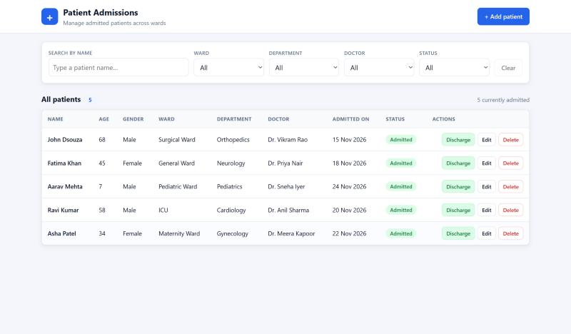
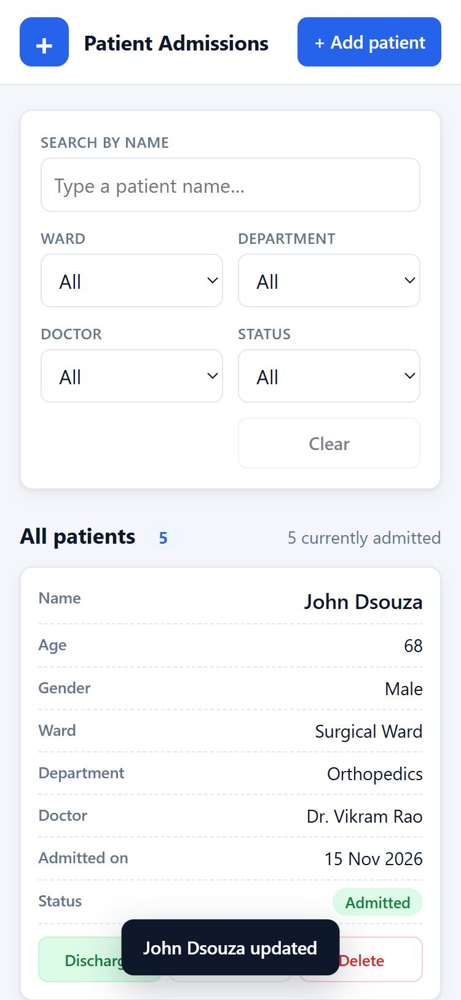
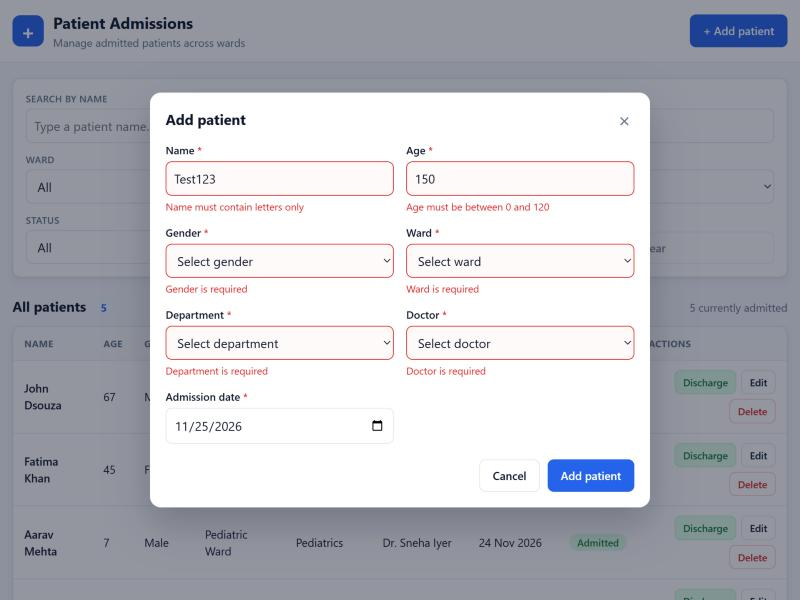
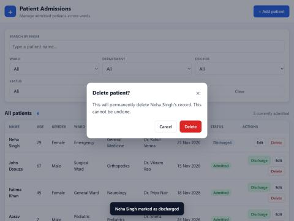

# Patient Admission Management App

A web app for hospital staff to manage admitted patients: add, view, search, filter, edit, discharge and delete patient records. Works on mobile, tablet and desktop.

| | Link |
|---|---|
| **Live app** | https://s-cribe-patients-management.vercel.app |
| **Live API** | https://scribe-patients-management.onrender.com ([interactive API docs](https://scribe-patients-management.onrender.com/docs)) |
| **Source code** | https://github.com/R2005ishi/SCribe_Patients_Management |

> The backend is on Render's free tier, which sleeps after ~15 minutes of inactivity. The first load can take 30–60 seconds while it wakes up. The app shows a "server is waking up" message during this time.

---

## Tech stack

| Layer | Technology |
|---|---|
| Frontend | React 18 (Vite), plain CSS (responsive, no UI library) |
| Backend | Python 3.12, FastAPI, Pydantic (validation), SQLAlchemy 2 (ORM) |
| Database | PostgreSQL (Neon) in production. SQLite file for local development |
| Hosting | Vercel (frontend), Render (backend), Neon (database) |
| Tests | pytest + FastAPI TestClient |

## Features

1. **Add a patient**: popup form with validation
2. **View all patients**: table on desktop/tablet, cards on mobile
3. **Filter** by Ward, Department and Doctor (plus Status)
4. **Search** patients by name (case-insensitive, as-you-type)
5. **Edit** a patient
6. **Delete** a patient, with a confirmation dialog
7. **Mark as Discharged**: one click (with confirmation). The status badge updates
8. **Responsive design**: mobile, tablet and desktop

### Validation (frontend **and** backend)

| Field | Rule |
|---|---|
| Name | Required. Letters only (single spaces allowed between words, e.g. "Asha Patel") |
| Age | Required. Whole number between 0 and 120 |
| Gender, Department | Required. Must be one of the allowed list values |
| Ward, Doctor | Required. Must exist in the `wards` / `doctors` table |
| Admission Date | Required. Cannot be a future date (checked in IST on the server) |

- **Frontend:** `frontend/src/validation.js` checks the form before sending and shows errors under each field.
- **Backend:** `backend/app/schemas.py` (Pydantic) validates every request again, so bad data is rejected even if someone calls the API directly. Errors come back as HTTP 422 with a clear message per field:

```json
{
  "detail": "Validation failed: Name must contain letters only; Age must be between 0 and 120",
  "errors": {
    "name": "Name must contain letters only",
    "age": "Age must be between 0 and 120"
  }
}
```

The frontend loads every dropdown list from `GET /api/options`, so the two sides always agree. **Wards and doctors are stored in their own database tables**. Gender, department and status lists are in `backend/app/constants.py`.

## Database

| Table | Columns | Notes |
|---|---|---|
| `wards` | id, name (unique) | Fills the Ward dropdown |
| `doctors` | id, name (unique) | Fills the Doctor dropdown |
| `patients` | id, name, age, gender, ward → `wards.name`, department, doctor → `doctors.name`, admission_date, status, created_at | `ward` and `doctor` are foreign keys |

- Tables are created automatically when the app starts. If `wards` or `doctors` is empty, it is filled with the defaults from `constants.py`.
- To add a ward or doctor, insert a row into its table. It appears in the dropdown right away and becomes valid for patients.
- The ward/doctor check happens in three layers: the frontend dropdown, the API (a 422 with a clear message if the value is not in the table), and the database foreign key.

## Screenshots

| Desktop | Mobile |
|---|---|
|  |  |

| Form validation | Delete confirmation |
|---|---|
|  |  |

## Architecture

```
React (Vercel)  ──HTTPS/JSON──►  FastAPI (Render)  ──SQLAlchemy──►  PostgreSQL (Neon)
 - form validation                - Pydantic validation
 - search/filter UI               - REST endpoints, CORS
```

### Project structure

```
backend/
  app/
    main.py        FastAPI app: routes, CORS, readable validation errors, ward/doctor checks
    schemas.py     Pydantic models = backend validation rules
    models.py      SQLAlchemy tables: Ward, Doctor, Patient
    crud.py        Database queries (seed wards/doctors, list/filter/search, create, update, discharge, delete)
    database.py    DB connection from DATABASE_URL (SQLite fallback for local dev)
    constants.py   Genders, departments, statuses + default wards/doctors used to fill the tables
  tests/           pytest tests for validation and all endpoints
frontend/
  src/
    App.jsx        Page state: list, filters, modals, toasts
    api.js         All HTTP calls to the backend
    validation.js  Frontend validation (same rules as backend)
    components/    Filters, PatientTable, PatientForm, ConfirmDialog, Modal
```

### API endpoints

| Method | Endpoint | Description |
|---|---|---|
| GET | `/api/health` | Health check |
| GET | `/api/options` | Dropdown values (wards and doctors read from the database) |
| GET | `/api/wards` | Ward names from the `wards` table |
| GET | `/api/doctors` | Doctor names from the `doctors` table |
| GET | `/api/patients?search=&ward=&department=&doctor=&status=` | List / search / filter |
| GET | `/api/patients/{id}` | Get one patient |
| POST | `/api/patients` | Add patient |
| PUT | `/api/patients/{id}` | Edit patient |
| PATCH | `/api/patients/{id}/discharge` | Mark as discharged |
| DELETE | `/api/patients/{id}` | Delete patient |

## Run locally

**Requirements:** Python 3.10+ and Node.js 18+.

### 1. Backend

```bash
cd backend
python -m venv .venv
# Windows:  .venv\Scripts\activate
# Mac/Linux: source .venv/bin/activate
pip install -r requirements.txt
uvicorn app.main:app --reload --port 8000
```

With no `DATABASE_URL` set, the app creates a local SQLite file (`patients.db`), so data stays saved between restarts. To use PostgreSQL, copy `.env.example` to `.env` and set `DATABASE_URL`.

API docs: http://localhost:8000/docs

Run the tests:

```bash
pytest
```

### 2. Frontend

```bash
cd frontend
npm install
npm run dev
```

Open http://localhost:5173. In development the frontend calls `http://localhost:8000`. To change it, copy `.env.example` to `.env` and set `VITE_API_URL`. Production builds use the Render URL from `frontend/.env.production`.

## Deployment

1. **Database (Neon):** create a free project and copy the PostgreSQL connection string.
2. **Backend (Render → New Web Service):**
   - Root directory: `backend`
   - Build command: `pip install -r requirements.txt`
   - Start command: `uvicorn app.main:app --host 0.0.0.0 --port $PORT`
   - Python version: pinned to 3.12.8 by `backend/.python-version`
   - Environment variables:
     - `DATABASE_URL`: the Neon connection string (secret, set only in the Render dashboard)
     - `FRONTEND_ORIGIN`: `https://s-cribe-patients-management.vercel.app,http://localhost:5173` (CORS: which sites may call the API)
3. **Frontend (Vercel → Import project):**
   - Root directory: `frontend`, framework preset: Vite
   - The backend URL comes from `frontend/.env.production` (`VITE_API_URL=https://scribe-patients-management.onrender.com`). It is a public URL, not a secret.

Every push to `main` redeploys both automatically. The tables are created (and wards/doctors filled) automatically on the first startup. The only secret, the database connection string, is never stored in this repository.
